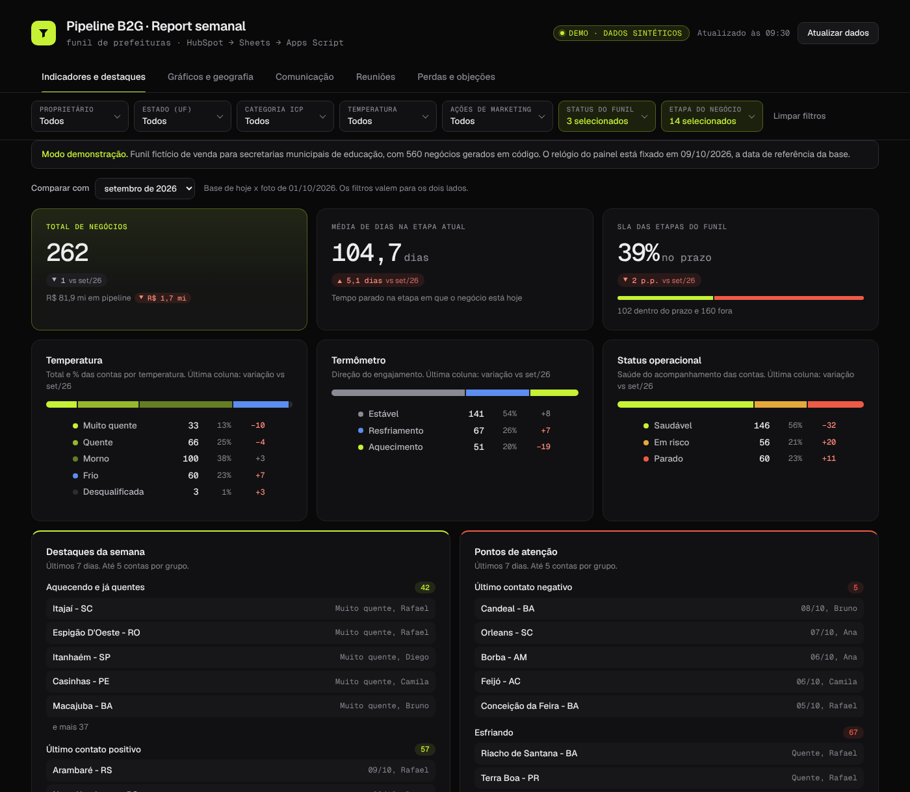
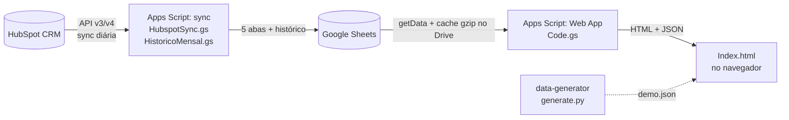
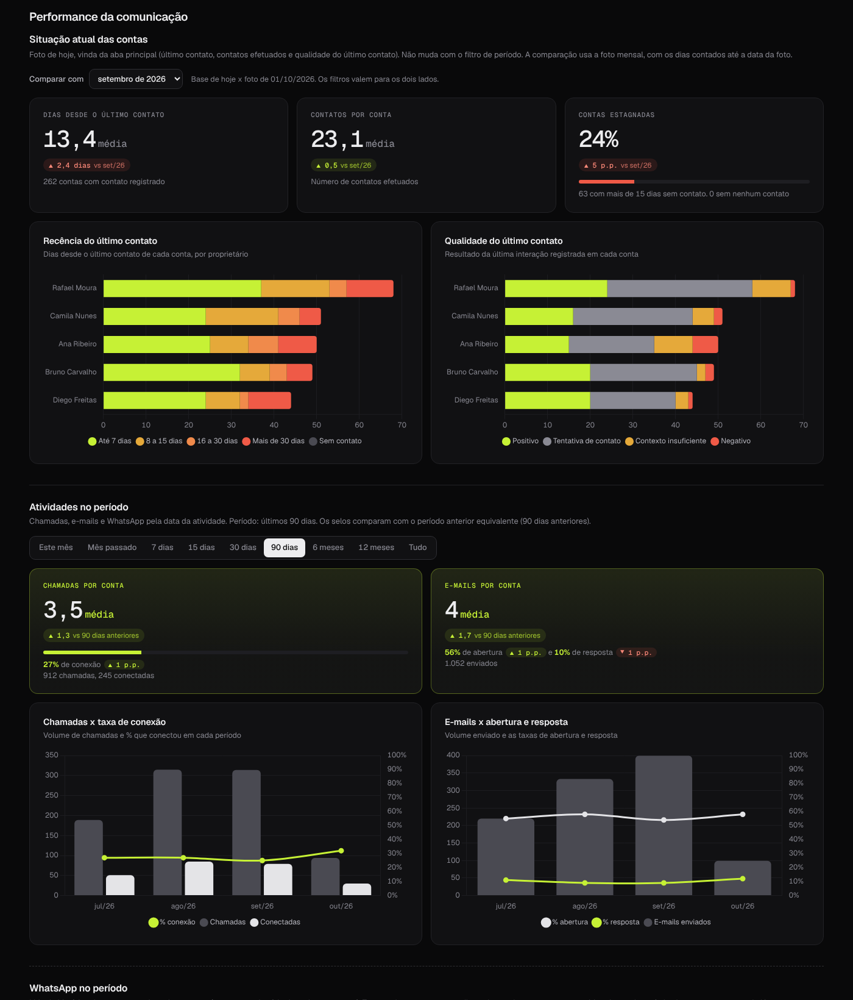
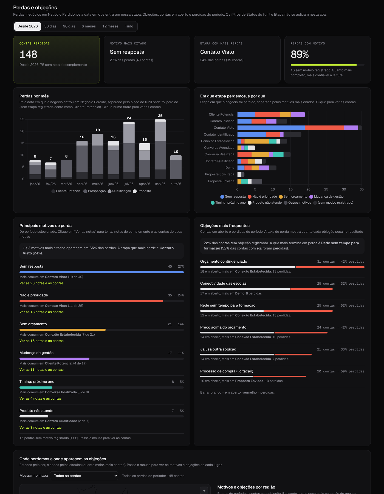

# HubSpot Pipeline Dashboard

Relatório semanal de um funil B2G que sai do HubSpot, passa por uma planilha e vira um painel web, sem servidor e sem ferramenta de BI paga. Tudo roda em Google Apps Script.

**[Ver a demonstração ao vivo](https://danielterra13-lang.github.io/hubspot-pipeline-dashboard/)** (dados sintéticos)



> Construí a primeira versão para o time comercial B2G de uma empresa de educação, que vende para secretarias municipais. Este repositório é uma reescrita genérica: nomes de propriedades neutros, configuração parametrizada e uma base **100% sintética** gerada em código. Nenhum dado, ID ou pessoa real aparece aqui.

## O problema

Antes de cada reunião semanal, alguém exportava cinco relatórios do HubSpot à mão, colava numa planilha e abria um Looker Studio que demorava e caía com frequência. O comparativo com o mês anterior era preenchido à mão. O funil não tinha histórico: o CRM mostra como cada negócio está hoje, não como estava no fim de agosto.

## O que o projeto faz

| | Antes | Depois |
|---|---|---|
| Atualização | 5 exports manuais por semana | Sync diária automática pela API |
| Abertura do painel | Looker lento, erro de conexão frequente | Web App com cache, abre em segundos |
| Comparativo mensal | Preenchido à mão | Foto automática todo dia 1 + meses passados reconstruídos pelo histórico do CRM |
| Regras de negócio | Espalhadas em filtros de relatório | Versionadas em código (deduplicação de reuniões, leitura de WhatsApp, SLA) |
| Acesso | Planilha compartilhada | Planilha privada; painel restrito ao domínio da empresa |

## Arquitetura



São **dois projetos de Apps Script, separados de propósito**. Um Web App deixa o navegador chamar qualquer função pública do projeto. Se a sync morasse junto, qualquer pessoa com o link poderia disparar a sincronização com as credenciais do dono. O projeto do painel só expõe `doGet` e `getData`.

Detalhes em [docs/arquitetura.md](docs/arquitetura.md).

## Destaques técnicos

- **Histórico reconstruído e validado.** Com `propertiesWithHistory`, o script calcula como cada negócio estava no último minuto de cada mês passado. Antes de confiar nisso, ele reconstrói a base de hoje pelo mesmo método e compara com o dado real, coluna a coluna: 98 a 100% de igualdade. [Como funciona](docs/historico-mensal.md).
- **Cache que derrubou a abertura de 40 a 63 segundos para poucos segundos.** O pacote de dados é compactado em gzip num arquivo do Drive e só é remontado quando a planilha muda, quando o painel pede outras colunas ou quando a versão do cache muda no código.
- **O cabeçalho da planilha é o contrato.** A sync preenche exatamente as colunas da linha 1, achando cada propriedade do HubSpot pelo rótulo. Coluna nova no painel = escrever o cabeçalho certo, sem tocar no código.

Os outros detalhes (busca fatiada contra o limite da Search API, escrita segura com alerta, deduplicação de reuniões, leitura de WhatsApp) e as alternativas descartadas estão em [docs/decisoes.md](docs/decisoes.md). Os problemas que apareceram em produção, e o que mudou por causa deles, estão em [docs/incidentes.md](docs/incidentes.md).

## O painel

Cinco abas, um arquivo HTML, JavaScript puro e Chart.js. Os filtros, o comparativo e todos os cálculos rodam no navegador depois que os dados chegam.

| Aba | O que responde |
|---|---|
| Indicadores e destaques | Tamanho e saúde do funil, SLA, temperatura, e o que mudou na semana. Comparativo com qualquer mês fechado. |
| Gráficos e geografia | Evolução do funil, contas prospectadas por mês, carteira por proprietário contra o limite, mapa por estado. |
| Comunicação | Chamadas, e-mails e WhatsApp por período, sempre contra o período anterior equivalente; esforço x avanço do funil. |
| Reuniões | Comparecimento, horários, visitas presenciais no mapa, depois de deduplicar os registros do CRM. |
| Perdas e objeções | Motivos e etapas de perda, objeções que mais derrubam negócios e o que pesa mais em cada região. |

<p>


</p>

## Rodar localmente

O modo demonstração não precisa de HubSpot nem de Google:

```bash
python3 data-generator/generate.py      # gera demo/demo.json (determinístico, seed 42)
python3 -m http.server 8000             # na raiz do repositório
# abra http://localhost:8000/apps-script/dashboard/Index.html
```

Fora do Apps Script e sem planilha configurada, o painel lê `demo.json` e congela o relógio na data de referência da base, para "últimos 7 dias" e "este mês" continuarem fazendo sentido.

Para usar com um HubSpot de verdade, siga [docs/setup.md](docs/setup.md).

## Estrutura

```
apps-script/
  sync/        HubspotSync.gs, HistoricoMensal.gs  → projeto vinculado à planilha (gatilho diário)
  dashboard/   Code.gs, Index.html                 → projeto publicado como App da Web
data-generator/
  generate.py            funil sintético com o mesmo formato das abas
  municipios_ibge.csv    lista pública de municípios (só para nomes e mapa)
demo/demo.json           saída do gerador, usada pelo GitHub Pages
docs/                    arquitetura, decisões, histórico, incidentes, setup, dados sintéticos
```

## Limitações conhecidas

- Google Sheets como armazenamento tem teto (10 milhões de células) e não é banco de dados. Para o volume de um time B2G sobra espaço; se crescer, o destino da escrita troca por um warehouse e a extração continua igual.
- O `Index.html` é um arquivo único grande. É fácil de publicar no Apps Script e difícil de testar. Separar em módulos com um build seria o próximo passo.
- Negócios excluídos ou mesclados no CRM somem do histórico reconstruído.
- A abertura de e-mail no HubSpot é medida por um pixel único: não distingue quem abriu. O painel trata resposta como indicador principal.

## In English

A weekly B2G pipeline report built entirely on Google Apps Script: a daily HubSpot API sync writes five sheets, a separate Web App serves a single-page dashboard with a Drive-backed gzip cache, and a monthly history is reconstructed from HubSpot property history and validated against current data (98–100% match per column). This repository is a generic rewrite of a production project, running on fully synthetic data generated by `data-generator/generate.py`. The live demo runs on GitHub Pages.

---

[Daniel Terra](https://danielterra13-lang.github.io) · Revenue Operations, dados e automação · [veja os outros projetos](https://danielterra13-lang.github.io)
