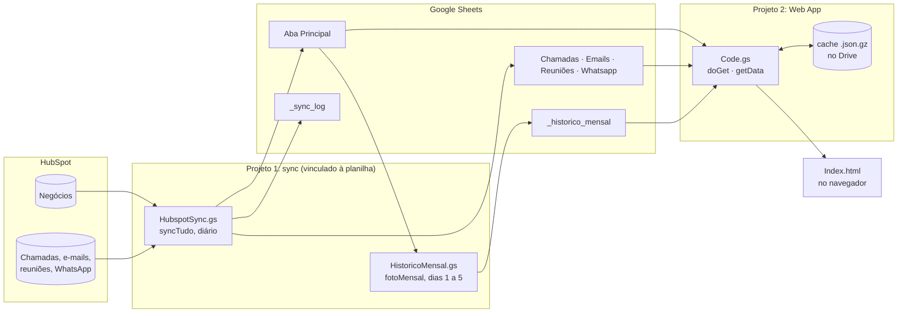

# Arquitetura



## As camadas

**Extração (HubspotSync.gs).** Um gatilho diário chama `syncTudo()`, que monta um contexto comum (proprietários, inclusive arquivados; etapas do pipeline; índice de propriedades; lista de negócios do pipeline) e grava cinco abas. No fim, chama `fotoMensal()`.

**Armazenamento (Google Sheets).** Uma aba por fonte, em formato largo, mais o histórico em formato longo. A planilha não é compartilhada com ninguém: quem lê é o Web App, rodando com a conta do dono.

**Entrega (Code.gs).** `doGet()` serve o HTML. `getData(spec)` devolve um JSON com só as colunas que o painel pediu, lido do cache quando possível.

**Apresentação (Index.html).** Recebe o JSON uma vez e faz todo o resto no navegador: parse, filtros, comparativos, gráficos e mapas. Trocar de aba ou filtro não volta ao servidor.

Uma analogia que funciona bem para explicar: o `Code.gs` é a cozinha, roda no Google, é o único com acesso à despensa (a planilha). O `Index.html` é o salão, roda no navegador de quem abriu e só recebe pratos prontos.

## O contrato: o cabeçalho da planilha

A sync não tem uma lista fixa de campos. Ela lê a linha 1 de cada aba e, para cada cabeçalho:

1. procura em `DEAL_COLS` (propriedades padrão, cujo rótulo da API vem em inglês);
2. procura uma propriedade com esse rótulo exato;
3. se o cabeçalho for `Date entered "Etapa (Pipeline)"`, usa `hs_v2_date_entered_<id da etapa>`;
4. se nada bater, a coluna fica vazia e o `_sync_log` registra "coluna sem propriedade".

O painel faz o mesmo do outro lado: `COLS` mapeia cada campo interno para um ou mais nomes de coluna e, quando faz sentido, uma expressão regular (útil para colunas com o nome do pipeline no meio). Coluna ausente vira aviso na tela, não erro.

O resultado é que adicionar um indicador costuma ser: criar o cabeçalho na planilha, mapear em `COLS` e desenhar. Nenhuma mudança na extração.

## Por que dois projetos de Apps Script

Um App da Web publicado expõe ao navegador, via `google.script.run`, todas as funções globais do projeto que não terminam em `_`. Se a sync estivesse no mesmo projeto, `syncTudo()` ou `listarPropriedades()` poderiam ser chamadas por qualquer pessoa com acesso ao link, executando com a conta e o token do dono. Separar custa um passo a mais na instalação e elimina essa superfície.

## Extração em detalhe

| Problema | Solução |
|---|---|
| Search API devolve no máximo 10 mil resultados por consulta | `searchByMonth_` fatia a consulta por mês da data da atividade |
| Atividade precisa estar ligada a um negócio do pipeline | Associações em lote pela API v4 (`pairWithDeals_`, 500 por chamada). Uma linha por par atividade x negócio, como no relatório nativo |
| Limite de taxa e instabilidade | `hs_` repete em 429 e 5xx com espera crescente; erros de escopo aparecem com a resposta do HubSpot |
| "Tempo na fase atual" não vem pela API | Calculado a partir de `hs_v2_date_entered_current_stage` |
| Resultados de chamada personalizados não estão nas opções da propriedade | Lidos de `/calling/v1/dispositions` |
| Falha no meio da execução | `writeTab_` só limpa a aba depois de ter todas as linhas em memória |
| Limite de 6 minutos por execução | `criarGatilhos()` separa a sync em três gatilhos se o volume crescer |

## Cache do Web App

```
getData(spec)
  ├─ spec mudou? → guarda o novo spec e invalida
  ├─ lerCache_():  CACHE_ID existe, CACHE_VER bate e a planilha não mudou depois do CACHE_AT?
  │     sim → devolve o arquivo .json.gz do Drive, descompactado
  └─ não → montarCache_(): lê as abas (só as colunas do spec), gera o JSON, grava gzip, apaga o antigo
```

`CACHE_AT` é gravado com o horário de antes da leitura. Se a planilha mudar durante a montagem, o próximo acesso remonta. Um gatilho de hora em hora (`aquecerCache`) mantém o cache pronto, então quase ninguém espera.

Durações merecem nota: o Sheets guarda "Tempo na fase atual" como data (30/12/1899 + a duração). Acima de um ano a data cai em 1900, 1901... Regra do `toTable_`: qualquer data antes de 1970 é duração e vai como texto formatado (`{f: "1052:13:20"}`).

## Formato dos dados entregues ao painel

O mesmo formato serve para o Web App, para a leitura via gviz e para o modo demonstração:

```json
{
  "main":   { "cols": [{"label": "Record ID"}, ...], "rows": [{"c": [{"v": 123}, {"f": "1052:13:20"}, null]}] },
  "calls":  { ... }, "emails": { ... }, "whats": { ... }, "meet": { ... },
  "hist":   { ... },
  "errs":   []
}
```

## Observabilidade

- `_sync_log`: uma linha por aba e execução (quando, aba, linhas, status, segundos, avisos).
- E-mail do script quando uma aba falha (as outras seguem).
- E-mail do próprio acionador quando a execução inteira cai.
- Foto mensal com nova tentativa diária até o dia 5 e e-mail se falhar.
